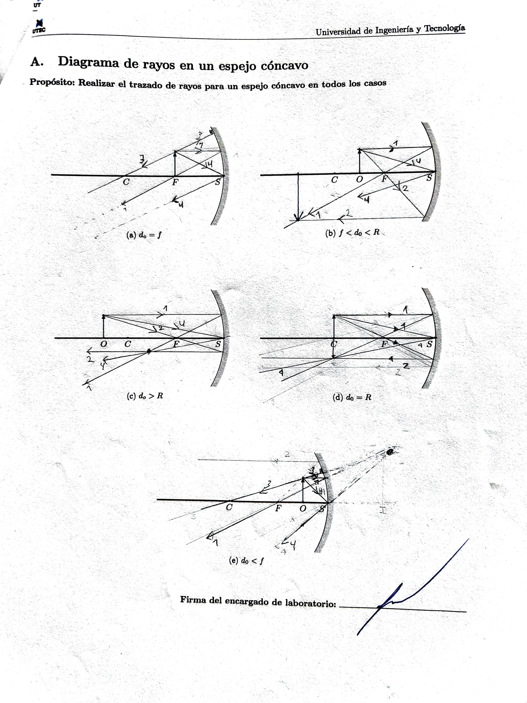
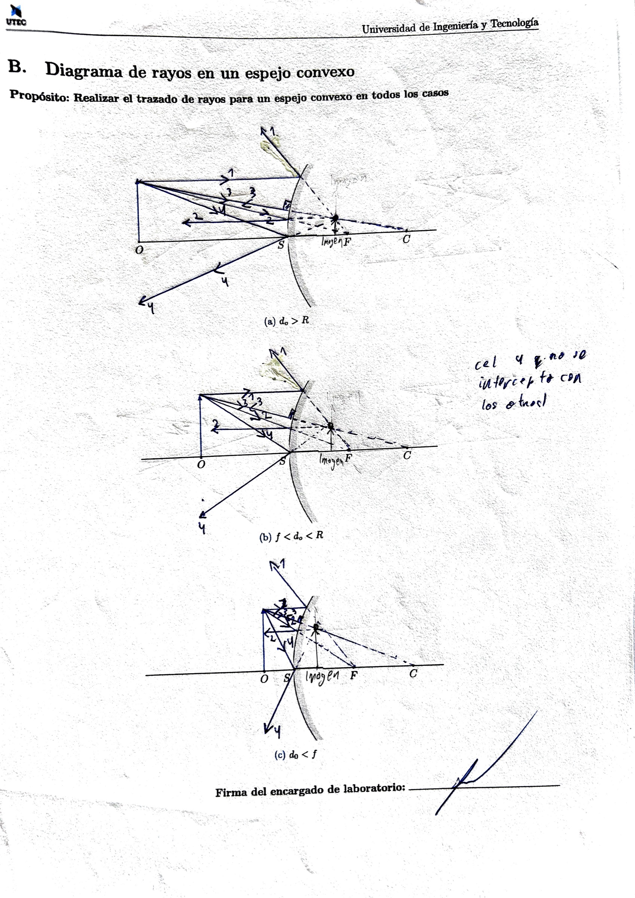
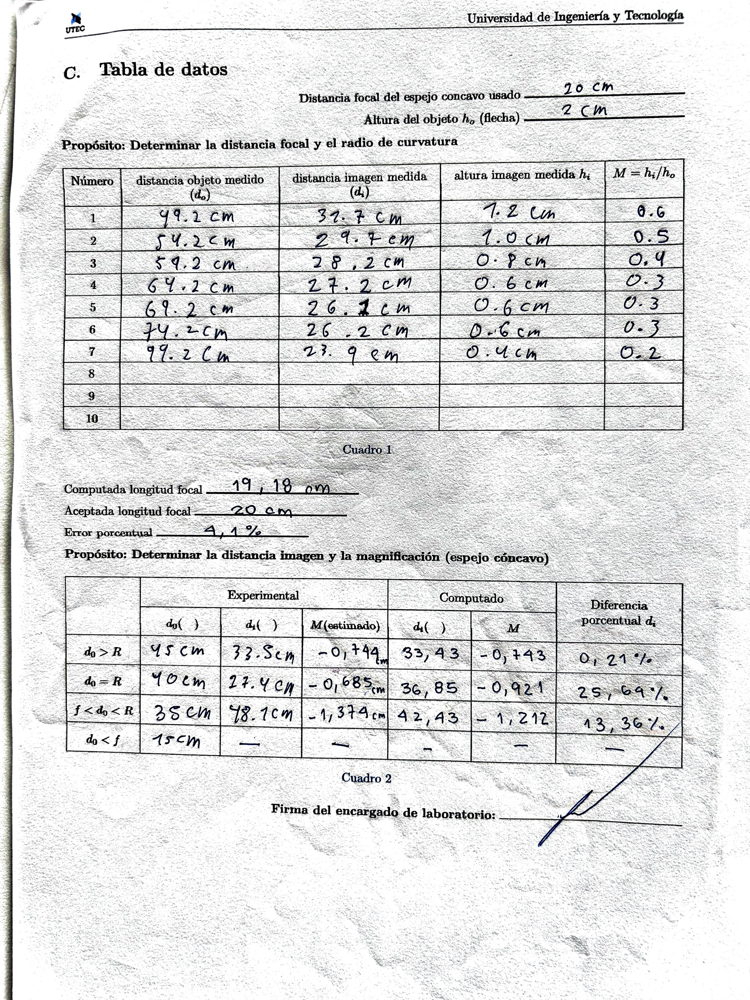
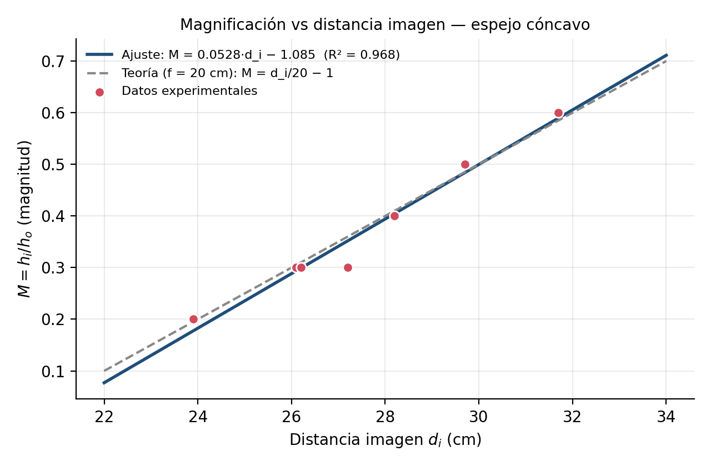

# Formación y análisis de imágenes en espejos cóncavos y convexos

**Universidad de Ingeniería y Tecnología (UTEC) — Departamento de Ciencias**
**Curso:** Óptica y Ondas — Laboratorio 2
**Integrantes:** [COMPLETAR: nombres y códigos]
**Fecha de la experiencia:** [COMPLETAR]

---

## Enlaces obligatorios (Apéndice E, puntos 3 y 5)

- **Video explicativo (YouTube, máx. 10 min):** [COMPLETAR: enlace de YouTube]
- **Datos experimentales y cálculos:** [COMPLETAR: enlace a Drive/Sheets/GitHub con los datos y el script `figuras/analisis.py`]

---

## 1. Introducción

### 1.1 Objetivos

1. Analizar las características de las imágenes formadas por un espejo cóncavo.
2. Calcular experimentalmente la distancia focal $f$ y el radio de curvatura $R$ de un espejo cóncavo.
3. Distinguir experimentalmente entre un espejo cóncavo y uno convexo.

### 1.2 Conclusión principal

A partir de 7 pares $(d_o, d_i)$ se obtuvo una distancia focal $f = 19.18 \pm 0.05$ cm (error de 4.1 % respecto al valor aceptado de 20 cm), y a partir del ajuste lineal de $M$ vs $d_i$ se obtuvo $f = 18.9 \pm 1.5$ cm y $R = 37.9 \pm 3.1$ cm ($R^2 = 0.968$). El espejo cóncavo forma imágenes reales e invertidas cuando $d_o > f$ y no forma imagen proyectable cuando $d_o < f$; el espejo convexo nunca formó imagen en la pantalla (imagen virtual), tal como predice el trazado de rayos.

### 1.3 Palabras clave

Espejo esférico (cóncavo y convexo) · Radio de curvatura · Longitud focal · Imagen real y virtual · Imagen derecha o invertida · Distancia objeto y distancia imagen · Factor de magnificación (aumento) · Método de trazado de rayos · Rayo paralelo, focal, radial y central.

---

## 2. Fundamento teórico

Un espejo esférico es una sección de esfera con centro de curvatura $C$ y vértice $V$ (o $S$). La distancia $\overline{CV}$ es el radio de curvatura $R$ y el foco $F$ está a la mitad:

$$f = \frac{R}{2} \tag{1}$$

La posición de la imagen se obtiene con la ecuación del espejo:

$$\frac{1}{d_o} + \frac{1}{d_i} = \frac{1}{f} \quad \Longleftrightarrow \quad d_i = \frac{d_o f}{d_o - f} \tag{2}$$

y el aumento con:

$$M = \frac{h_i}{h_o} = -\frac{d_i}{d_o} \tag{3}$$

Combinando (2) y (3) se obtiene una relación **lineal** entre $M$ y $d_i$, que es la base del ajuste de la sección 5:

$$M = 1 - \frac{d_i}{f} \qquad \Longrightarrow \qquad |M| = \frac{1}{f}\,d_i - 1 \quad (\text{imagen real, invertida}) \tag{4}$$

**Convención de signos (Apéndice D.3):**

| Variable | Condición | Signo |
|---|---|---|
| Longitud focal $f$ | Espejo cóncavo / convexo | + / − |
| Distancia objeto $d_o$ | En todo el experimento | + |
| Distancia imagen $d_i$ | Imagen real / virtual | + / − |
| Magnificación $M$ | Imagen derecha / invertida | + / − |

**Rayos para el trazado:** (1) rayo paralelo, se refleja pasando por $F$ (o parece venir de $F$ en el convexo); (2) rayo focal, pasa por $F$ y sale paralelo al eje; (3) rayo radial, pasa por $C$ y regresa sobre sí mismo; (4) rayo central, incide en el vértice y se refleja simétricamente respecto al eje.

---

## 3. Métodos

### 3.1 Equipo utilizado

1. Riel óptico (banco óptico graduado).
2. Fuente de luz óptica con flecha (objeto, $h_o = 2$ cm).
3. Soporte para pantalla (con tira gruesa de hoja Bond doblada como pantalla).
4. Soportes deslizantes.
5. Espejo cóncavo-convexo de doble cara ($f$ nominal = 20 cm).
6. Regla de 30 cm, hojas Bond y plumón/lápiz.

> [FOTO: arreglo experimental en el riel — `fotos/arreglo.jpg`]

### 3.2 Procedimiento

**Trazado de rayos (antes del experimento).**

1. Espejo cóncavo (Apéndice A): se trazaron los diagramas para $d_o = f$, $d_o > R$, $d_o = R$, $f < d_o < R$ y $d_o < f$.
2. Espejo convexo (Apéndice B): se trazaron los diagramas para $d_o > R$, $f < d_o < R$ y $d_o < f$.

**Determinación de $f$ y $R$ (Cuadro 1).**

3. Se montaron la fuente, el soporte de pantalla y el espejo en el riel, con la cara **cóncava** hacia la fuente. La fuente se fijó con una tira de papel.
4. La pantalla se hizo doblando una tira de hoja Bond hasta formar una hoja gruesa y compacta.
5. Se colocó el objeto (borde de la fuente) en la posición 0 cm del riel, se encendió la fuente y se midió la altura del objeto: $h_o = 2$ cm.
6. Se fijó el espejo a una distancia $d_o$ y se movió la pantalla hasta obtener la imagen más nítida (se discutió en grupo la mejor posición). Se registraron $d_o$ y $d_i$.
7. Sin mover la pantalla, se marcaron con plumón los extremos de la imagen y se midió $h_i$ con la regla.
8. Se repitió para 7 distancias objeto separadas uniformemente (cada 5 cm entre 49.2 y 74.2 cm, más 99.2 cm).

> [FOTO: imagen desenfocada vs enfocada en la pantalla]
> [FOTO: marcas de plumón y medición de $h_i$ con la regla]

**Casos del espejo cóncavo (Cuadro 2).**

9. Se colocó el objeto en $d_o > R$ (45 cm), $d_o = R$ (40 cm), $f < d_o < R$ (35 cm) y $d_o < f$ (15 cm). En cada caso se buscó la imagen en la pantalla, se midió $d_i$ y se estimó $M = -d_i/d_o$ (sin medir alturas, según la guía). Luego se calculó $d_i$ teórico con la ecuación (2) y la diferencia porcentual.

**Espejo convexo.**

10. Se giró el espejo a la cara convexa y se intentó formar la imagen en la pantalla para distintas $d_o$ arbitrarias.

> [FOTO: intento de formar imagen con el espejo convexo]

---

## 4. Resultados

### 4.1 Diagramas de rayos (Apéndices A y B, firmados)

Características de la imagen predichas por los diagramas:

| Espejo | Caso | Ubicación de la imagen | Tipo | Orientación | Tamaño |
|---|---|---|---|---|---|
| Cóncavo | $d_o > R$ | Entre $F$ y $C$ | Real | Invertida | Reducida |
| Cóncavo | $d_o = R$ | En $C$ | Real | Invertida | Igual tamaño |
| Cóncavo | $f < d_o < R$ | Más allá de $C$ | Real | Invertida | Ampliada |
| Cóncavo | $d_o = f$ | No se forma (rayos reflejados paralelos, imagen en el infinito) | — | — | — |
| Cóncavo | $d_o < f$ | Detrás del espejo | Virtual | Derecha | Ampliada |
| Convexo | $d_o > R$ | Detrás del espejo, entre $S$ y $F$ | Virtual | Derecha | Reducida |
| Convexo | $f < d_o < R$ | Detrás del espejo, entre $S$ y $F$ | Virtual | Derecha | Reducida |
| Convexo | $d_o < f$ | Detrás del espejo, entre $S$ y $F$ (más cerca de $S$) | Virtual | Derecha | Reducida (menos reducida) |

### 4.2 Datos experimentales (Apéndice C, firmado)

- Distancia focal del espejo cóncavo usado (nominal): $f_{\text{acep}} = 20$ cm
- Altura del objeto: $h_o = 2.0$ cm

**Cuadro 1.** Medidas para determinar $f$ y $R$. Las dos últimas columnas son calculadas.

| N.º | $d_o$ (cm) | $d_i$ (cm) | $h_i$ (cm) | $M = h_i/h_o$ | $f_k = \left(\frac{1}{d_o}+\frac{1}{d_i}\right)^{-1}$ (cm) | $d_i/d_o$ |
|---|---|---|---|---|---|---|
| 1 | 49.2 | 31.7 | 1.2 | 0.6 | 19.28 | 0.644 |
| 2 | 54.2 | 29.7 | 1.0 | 0.5 | 19.19 | 0.548 |
| 3 | 59.2 | 28.2 | 0.8 | 0.4 | 19.10 | 0.476 |
| 4 | 64.2 | 27.2 | 0.6 | 0.3 | 19.10 | 0.424 |
| 5 | 69.2 | 26.1 | 0.6 | 0.3 | 18.95 | 0.377 |
| 6 | 74.2 | 26.2 | 0.6 | 0.3 | 19.36 | 0.353 |
| 7 | 99.2 | 23.9 | 0.4 | 0.2 | 19.26 | 0.241 |

*Nota:* $M$ se registró en magnitud; como la imagen es invertida, el valor con signo es $M = -h_i/h_o$.

### 4.3 Cálculo de la distancia focal (Cuadro 1)

Para cada fila se aplicó la ecuación (2). Ejemplo, fila 1:

$$f_1 = \left(\frac{1}{49.2} + \frac{1}{31.7}\right)^{-1} = \left(0.02033 + 0.03155\right)^{-1} = 19.28 \text{ cm}$$

Promedio y dispersión de los 7 valores:

$$\bar f = 19.18 \text{ cm}, \qquad s_f = 0.14 \text{ cm}, \qquad \sigma_{\bar f} = \frac{s_f}{\sqrt{7}} = 0.05 \text{ cm}$$

$$\boxed{f_{\text{comp}} = 19.18 \pm 0.05 \text{ cm}} \qquad R = 2f = 38.36 \pm 0.10 \text{ cm}$$

$$\text{Error porcentual} = \frac{|19.18 - 20|}{20}\times 100\% = 4.1\%$$

| Computada longitud focal | Aceptada longitud focal | Error porcentual |
|---|---|---|
| 19.18 cm | 20 cm | 4.1 % |

### 4.4 Distancia imagen y magnificación por casos (Cuadro 2)

Valores computados con $f = 19.18$ cm, $d_i = \dfrac{d_o f}{d_o - f}$, $M = -\dfrac{d_i}{d_o}$ y diferencia $= \dfrac{|d_{i,\text{exp}} - d_{i,\text{comp}}|}{d_{i,\text{comp}}}\times 100\%$.

**Cuadro 2.**

| Caso | $d_o$ (cm) | $d_i$ exp. (cm) | $M$ estimado $= -d_i/d_o$ | $d_i$ comp. (cm) | $M$ comp. | Diferencia % $d_i$ |
|---|---|---|---|---|---|---|
| $d_o > R$ | 45 | 33.5 | −0.744 | 33.43 | −0.743 | 0.21 % |
| $d_o = R$ | 40 | 27.4 | −0.685 | 36.85 | −0.921 | 25.64 % |
| $f < d_o < R$ | 35 | 48.1 | −1.374 | 42.43 | −1.212 | 13.36 % |
| $d_o < f$ | 15 | No se formó imagen en la pantalla | — | −68.83 (virtual) | +4.59 | — |

Ejemplo de cálculo ($d_o > R$):

$$d_i = \frac{45 \times 19.18}{45 - 19.18} = \frac{863.1}{25.82} = 33.43 \text{ cm}, \quad M = -\frac{33.43}{45} = -0.743, \quad \frac{|33.5 - 33.43|}{33.43}\times100\% = 0.21\%$$

Caso $d_o < f$ (teórico): $d_i = \dfrac{15 \times 19.18}{15 - 19.18} = -68.83$ cm (negativo → **virtual**), $M = +4.59$ (positivo → **derecha y ampliada**).

> *Nota de corrección:* en la hoja firmada se anotó 25.69 % para $d_o = R$; el cálculo da 25.64 %. Las magnificaciones son adimensionales (en la hoja aparecen con "cm" por error de escritura).

### 4.5 Espejo convexo

Con la cara convexa hacia la fuente no fue posible proyectar la imagen en la pantalla para ninguna distancia objeto probada → la imagen es **virtual**. [COMPLETAR: distancias $d_o$ probadas y lo observado al mirar directamente el espejo, p. ej. imagen derecha y reducida.]

> [FOTO: evidencia espejo convexo]

---

## 5. Análisis de datos

### 5.1 Gráfico de $M = h_i/h_o$ en función de $d_i$

**¿Qué se esperaba?** De la ecuación (4), $|M| = d_i/f - 1$: una **recta** de pendiente $1/f$ e intercepto $-1$. Es decir, a mayor $d_i$ (objeto más cerca del foco), mayor aumento; y $|M| = 1$ cuando $d_i = 2f = R$. Los datos muestran exactamente esa tendencia creciente y lineal.

### 5.2 Ajuste de curva

Ajuste lineal por mínimos cuadrados $|M| = a\,d_i + b$:

$$a = 0.0528 \pm 0.0043 \ \text{cm}^{-1}, \qquad b = -1.09 \pm 0.12$$

$$\boxed{|M| = 0.0528\,d_i - 1.085} \qquad \left(\text{con signo: } M = -0.0528\,d_i + 1.085\right)$$

**Bondad del ajuste:** coeficiente de determinación $R^2 = 0.968$ (correlación $r = 0.984$). El 96.8 % de la variación de $M$ queda explicada por el modelo lineal. Además, el intercepto $b = -1.09 \pm 0.12$ es compatible con el valor teórico $-1$, lo que valida el modelo.

### 5.3 Distancia focal y radio de curvatura a partir del ajuste

$$f = \frac{1}{a} = \frac{1}{0.0528} = 18.9 \pm 1.5 \text{ cm}, \qquad R = 2f = 37.9 \pm 3.1 \text{ cm}$$

(incertidumbre propagada: $\sigma_f = \sigma_a / a^2$). Error respecto al valor aceptado: $|18.9 - 20|/20 = 5.4\%$. El valor de 20 cm está dentro de la incertidumbre del ajuste, y $f$ es consistente con el obtenido por la ecuación del espejo (19.18 cm).

**Justificación:** el ajuste es lineal porque la ecuación (4) lo exige físicamente, no por elección arbitraria. La incertidumbre del ajuste es mayor que la del promedio porque $h_i$ se midió con regla y resolución de ~0.1–0.2 cm sobre imágenes de 0.4–1.2 cm, lo que da errores relativos de 10–25 % en $M$ (por ejemplo, el punto $d_i = 27.2$ cm con $M = 0.3$ se aleja de la recta).

### 5.4 Características de la imagen (Cuadro 2) vs diagrama de rayos

| Caso | Observado experimentalmente | Diagrama de rayos | ¿Coincide? |
|---|---|---|---|
| $d_o > R$ (45 cm) | Real (en pantalla), invertida, reducida ($|M| = 0.74$) | Real, invertida, reducida | Sí |
| $d_o = R$ (40 cm) | Real, invertida, reducida ($|M| = 0.69$) | Real, invertida, igual tamaño ($|M| = 1$) | Parcial: tipo y orientación sí; tamaño no |
| $f < d_o < R$ (35 cm) | Real, invertida, ampliada ($|M| = 1.37$) | Real, invertida, ampliada | Sí |
| $d_o < f$ (15 cm) | No se forma en pantalla → virtual | Virtual, derecha, ampliada | Sí |
| Convexo (cualquier $d_o$) | No se forma en pantalla → virtual | Virtual, derecha, reducida | Sí |

**Discusión:** cuatro de los cinco casos coinciden plenamente con el trazado de rayos. En $d_o = R$ la imagen sí fue real e invertida, pero la $d_i$ medida (27.4 cm) es 25.6 % menor que la teórica; además es inconsistente con la tendencia del Cuadro 1 (para $d_o = 49.2$ cm ya se midió $d_i = 31.7$ cm, y al acercar el objeto $d_i$ debe aumentar). Esto indica un error de medición en ese punto (probablemente la pantalla quedó en una posición de enfoque aparente o hubo un error de lectura del riel), no una falla del modelo. Hay que notar también que con $f = 19.18$ cm, $R = 38.36$ cm, por lo que $d_o = 40$ cm está ligeramente por encima de $R$ y la imagen teórica es levemente reducida ($M = -0.92$).

---

## 6. Discusión

### 6.1 Comparación cóncavo vs convexo

- **Cóncavo (convergente, $f > 0$):** forma imágenes reales e invertidas si $d_o > f$ (proyectables en pantalla) y virtuales, derechas y ampliadas si $d_o < f$. El tamaño depende de la posición del objeto respecto a $C$.
- **Convexo (divergente, $f < 0$):** para cualquier $d_o > 0$, $d_i = \frac{d_o f}{d_o - f} < 0$ y $0 < M < 1$: imagen siempre virtual, derecha y reducida. Por eso nunca se pudo proyectar en la pantalla, lo que permite distinguir experimentalmente ambos espejos.

### 6.2 Fuentes de error

1. **Criterio de enfoque:** la posición de "mejor enfoque" tiene una profundidad de campo de ~1 cm y depende del observador.
2. **Medición de $h_i$:** marcas de plumón con grosor apreciable y regla con resolución de 1 mm sobre imágenes pequeñas → error relativo grande en $M$.
3. **Posición del vértice:** el vértice del espejo no coincide exactamente con la marca del soporte; un desfase sistemático en $d_o$ y $d_i$ explicaría que $f$ salga ~0.8 cm menor que el nominal en todas las filas.
4. **Aberración esférica y alineación:** espejo y fuente no perfectamente centrados en el eje óptico; rayos no paraxiales.
5. **Luz ambiental** que reduce el contraste de la imagen y dificulta el enfoque.
6. **Lectura del riel** (posible error de lectura en el caso $d_o = R$).

### 6.3 Sugerencias

- Medir cada $d_i$ dos o tres veces (acercando y alejando la pantalla) y promediar.
- Usar una pantalla con escala milimetrada impresa para medir $h_i$ sin marcar, o fotografiar la pantalla junto a una regla.
- Usar un objeto más grande para reducir el error relativo de $M$.
- Medir la posición real del vértice del espejo respecto a la marca del soporte y corregir las distancias.
- Trabajar con menor luz ambiental.

### 6.4 Reflexión adicional

1. **Ajuste restringido al modelo físico.** Si se fija el intercepto en $-1$ (lo que exige la ecuación 4) y solo se ajusta la pendiente, se obtiene $f = 20.1$ cm (error 0.5 %). Esto muestra que la mayor parte de la desviación del ajuste libre proviene del ruido en $h_i$, no de un error en el modelo.
2. **$M$ a partir de distancias.** Usando $|M| = d_i/d_o$ (sin medir alturas) el ajuste da $|M| = 0.0516\,d_i - 0.985$ con $R^2 = 0.9945$ y $f = 19.4 \pm 0.7$ cm (error 3.1 %): las distancias se miden con mucha más precisión que las alturas.
3. **Linealización alternativa.** Graficando $1/d_o$ vs $1/d_i$ se obtiene pendiente $-0.995$ (teórica $-1$) e intercepto $1/f = 0.0520$ cm$^{-1}$ → $f = 19.25$ cm, $R^2 = 0.988$. Los tres métodos coinciden en $f \approx 19$–$20$ cm.
4. **Signo de $M$.** La guía pide graficar $M = h_i/h_o$; como todas las imágenes del Cuadro 1 son invertidas, el valor físico es negativo y la recta con signo tiene pendiente $-1/f$. La información de $f$ es la misma.
5. **Aplicaciones:** el espejo convexo se usa en retrovisores y vigilancia porque su imagen virtual, derecha y reducida amplía el campo visual; el cóncavo, en linternas (fuente en $F$ → haz paralelo, caso $d_o = f$) y espejos de maquillaje (caso $d_o < f$, imagen derecha y ampliada).

---

## 7. Conclusiones

1. Se determinó experimentalmente la distancia focal del espejo cóncavo: $f = 19.18 \pm 0.05$ cm por la ecuación del espejo (error 4.1 %) y $f = 18.9 \pm 1.5$ cm por el ajuste de $M$ vs $d_i$ (error 5.4 %); el radio de curvatura es $R \approx 38$ cm.
2. La relación $M$ vs $d_i$ es lineal ($R^2 = 0.968$) con intercepto compatible con $-1$, confirmando la ecuación del espejo.
3. Las imágenes observadas coinciden con el trazado de rayos: reales e invertidas para $d_o > f$ (reducidas si $d_o > R$, ampliadas si $f < d_o < R$) y virtuales para $d_o < f$. El caso $d_o = R$ presentó una discrepancia de 25.6 % en $d_i$ atribuida a un error de medición.
4. El espejo convexo nunca formó imagen en la pantalla: su imagen es siempre virtual, derecha y reducida, lo que permite distinguirlo experimentalmente del cóncavo.

---

## Anexos

- Apéndices A, B y C firmados por el encargado de laboratorio (sección 4).
- Fotografías tomadas durante el laboratorio: [COMPLETAR: montaje, imagen enfocada, medición de $h_i$, espejo convexo].
- Script de análisis: `figuras/analisis.py`.
